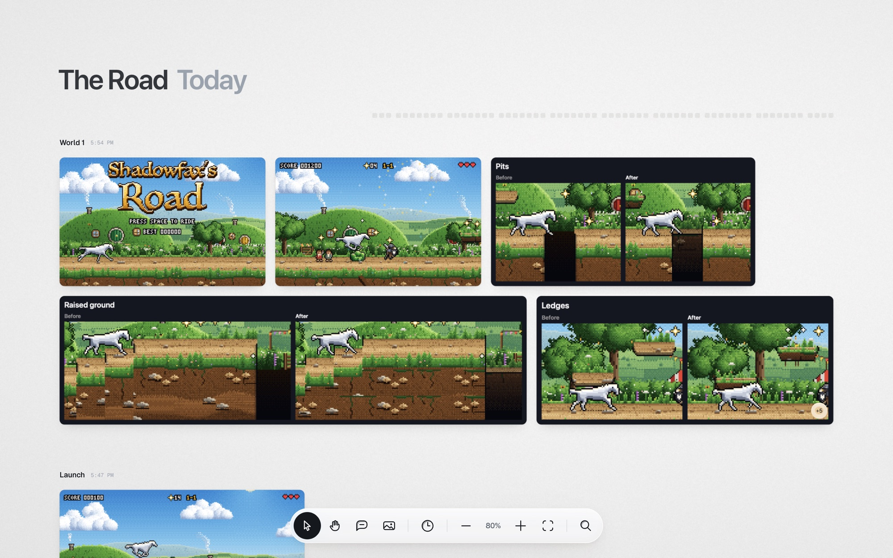
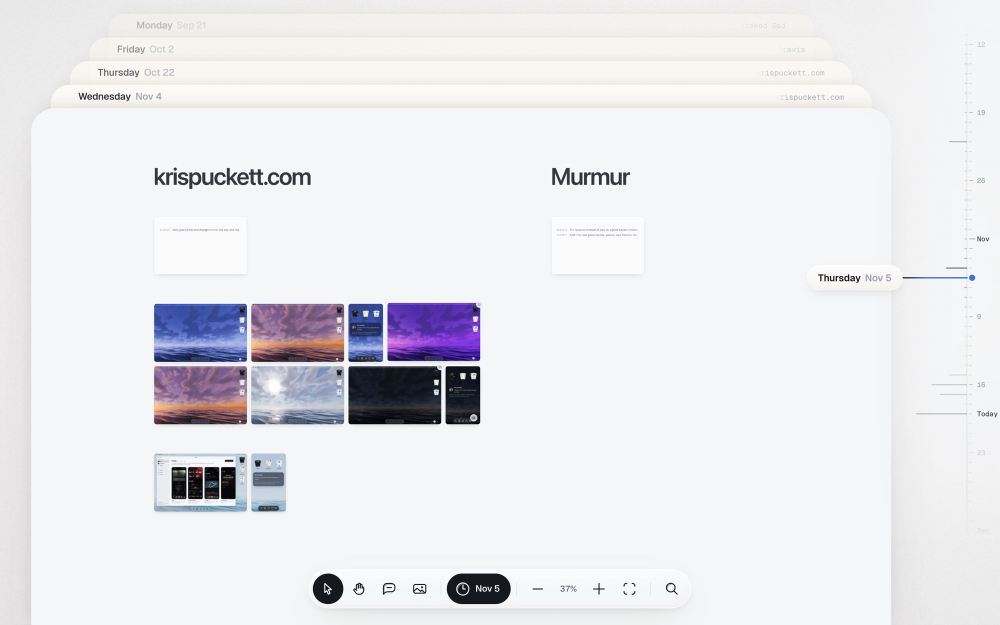

<p align="center">
  
</p>

<h1 align="center">Rounds</h1>

<p align="center">One canvas for everything your Claude Code sessions make.</p>

[](docs/rounds-film.mp4)

<p align="center"><a href="docs/rounds-film.mp4">Watch the film</a> (21 seconds), or <a href="docs/rounds-film-phone.mp4">the cut for phones</a></p>

I run a lot of Claude Code sessions at once, and I kept losing track of what each one had made.
So I built Rounds. The screens a session shows me, the pages it publishes and the changes it
pushes to main all land on one canvas, sorted by project. I look it over, pin a note on whatever
needs work, and the note goes back to the session that made it. It all runs on your Mac.

## Try it

```bash
npx github:krispuckett/rounds --demo
```

The demo is my own work: six public projects (my site, a pixel-art game, a Tour de France
gallery, an essay site, a Swift package and an app's landing page), rebuilt from their git
history. The 23 notes on it are notes I actually left, each answered by the commit that came
next. It runs in its own folder and never reads yours.

## What it does

### Your sessions' work, by project



Work lands under the project it was made in, grouped by topic. A topic like "World 1" gathers
its screens across sessions and days, with the newest on top.

### Notes go back to the session


Press C, click a screen and pin a note. The next time you type in the session that made it, the
note comes along with your message. The session makes the fix, posts the new screen and answers
on the pin. Here I told it Rohan was too hard, and it gave the arrows a warning and kept
Shadowfax white against the field.

Only that session gets the note, even when two sessions work in the same repo.

### Before and after


When a session replaces a screen, the old one stays as its before. Drag the line to compare, or
hold Space. This is my site's evening sky, before and after I told the session the sunset felt
way too purple.

### Go back to any day



The clock in the dock stacks up the days that had work. Scroll to step back through them, or
drag the rail on the right to travel further, and the canvas re-forms to what existed that day.

### Pushes

When a session pushes to main, it records what changed, with the commits and a before and after
of the screens they touched. An optional git hook catches the pushes you make outside Claude.

## Set it up

You need a Mac, Node 20 or newer, and Claude Code. If you have Chrome or another Chromium
browser, Rounds uses it for page previews.

```bash
npx github:krispuckett/rounds init
```

Init asks before each step:

1. The MCP server, so sessions can post to the canvas and read your notes.
2. The `rounds` skill, which tells Claude when to post and what to do with a note.
3. The hooks, which bring each session its notes and record its pushes.
4. A git hook for the repo you're in, if you're in one, for pushes made outside Claude.

Then it reads your Claude Code transcripts once, so screens and pages from before you installed
it show up too. New sessions use Rounds right away; restart any that are already open.

Open the canvas:

```bash
npx github:krispuckett/rounds
```

It runs at http://localhost:4797.

## How it works

The MCP server gives each session four tools:

| Tool | What it does |
| --- | --- |
| `rounds_post` | Puts screens or an HTML page on the canvas, with a caption, a topic, and a before when there is one |
| `rounds_change` | Records a push to main: the commit range, a plain summary, and before and after screens |
| `rounds_notes` | Lists the notes waiting on this session's work |
| `rounds_reply` | Answers a note on its pin |

A `UserPromptSubmit` hook delivers notes. A `PostToolUse` hook ties each post to its session and
spots pushes to main by reading git's own log. Each one runs in under 50 ms.

If a session runs in auto mode, Claude Code's safety check can hold back a change that only a
note asked for. The session asks you first, and your yes lets it go ahead.

<details>
<summary>Keys</summary>

| Key | Does |
| --- | --- |
| V, H, C | Move, hand, comment |
| T | Open the time machine |
| ← → | A day back, a day forward |
| / or ⌘K | Search |
| 0, +, − | Fit everything, zoom in, zoom out |
| Space | Hold to pan; while comparing, hold to see the before |
| Esc | Back out of whatever is open, then back to today |

Two-finger scroll pans and pinch zooms. With a mouse, ⌘ scroll zooms. Drop an image or an HTML
file on the canvas to add it to a project yourself.

</details>

## Privacy

Everything lives in `~/.rounds` on your Mac. The server listens on 127.0.0.1 and turns away
requests from websites, so a page you visit can't read your canvas or slip a note into a session.

A note reaches its session the same way your typing does. Screens found in old transcripts come
without a topic, so Rounds asks Claude Haiku to file them through your own `claude -p`, sending
each one's caption, session name and file names. Anything that matches a word in your `private`
list is never indexed at all.

<details>
<summary>Config</summary>

`~/.rounds/config.json`. Every field is optional.

```json
{
  "projects": [{ "key": "shop", "name": "Shop", "match": ["shop", "storefront"] }],
  "private": ["acme-internal"],
  "folders": true,
  "home": "Home",
  "port": 4797
}
```

- **projects** names a project and the words that put work in it, matched against the session's
  name, its folder and the caption.
- **private** keeps anything that matches off the canvas.
- **folders**, when on, names work no rule claims for its repo.
- **home** names work that belongs to no project, like a session run from your home folder.
- **port** is where the canvas serves.
- **relay**, for the Claude desktop app: with a session running `relay/RELAY.md`, a note reaches
  its session the moment you pin it.

Environment variables override the defaults:

| Variable | Sets |
| --- | --- |
| `ROUNDS_HOME` | The data folder, instead of `~/.rounds` |
| `ROUNDS_PORT` | The port, instead of the config's |
| `ROUNDS_CLAUDE_HOME` | The Claude folder to read, instead of `~/.claude`. Point it at a stand-in and init writes there, leaving your real setup alone. |
| `ROUNDS_DESKTOP_SESSIONS` | Where the Claude desktop app keeps its session records |
| `ROUNDS_BROWSER` | The Chromium browser for page previews, or `none` to turn them off |

</details>

## Uninstall

```bash
npx github:krispuckett/rounds uninstall
```

This removes the MCP server, the skill, the hooks, the copy in `~/.rounds/app` and the git hook
of the repo you run it from. Your canvas stays in `~/.rounds` until you delete it. If init
changed your Claude settings, the earlier ones are saved as
`~/.claude/settings.json.before-rounds`.

## Develop

```bash
npm install
npm run dev     # the canvas with live reload, on :4797
npm run eval    # the whole loop with real Claude sessions
```

The canvas is Vite, React and TypeScript. The server, the MCP server and the hooks are plain
Node, and the one runtime dependency is playwright-core, for page previews. `npm run eval` takes
real Claude Code sessions through the whole loop in a throwaway folder (post, note, fix, reply,
push) and checks 15 things on the way, for about $1.25 a run.

## License

MIT. Made by [Kris Puckett](https://krispuckett.com).
