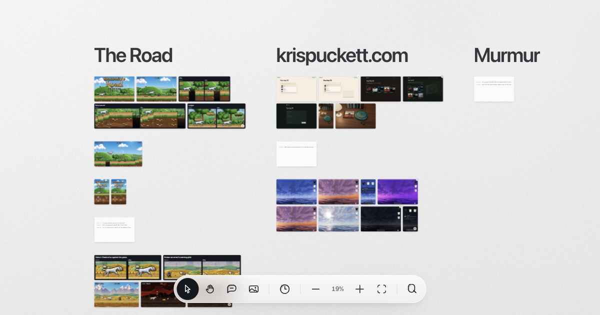

# Rounds

A local canvas of everything your Claude Code sessions make.

The screens a session builds, the pages it publishes and the changes it pushes all land on one
canvas, grouped by project, topic and moment. A time machine takes the canvas back to any earlier
day that had work. Open a screen to compare its before and after, or pin a note on it. The note
goes back into the session that made the screen, which acts on it and answers on the pin.

[](docs/rounds-film.mp4)

[Watch the film](docs/rounds-film.mp4), or [the cut for phones](docs/rounds-film-phone.mp4).

## A first look

```bash
npx rounds-app --demo
```

This opens the canvas on real work from six of my public projects: my site (krispuckett.com), a
web game (The Road), a Tour de France gallery (Le Tour), an essay site (Stoked Dad), an open
source Swift package (Murmur) and an app's landing page (Praxis). Each was rebuilt from its own git
history, with screens of the work as it stood at each commit and 23 of my real notes, each
answered by the commit that followed it.

The demo runs in its own folder, `~/.rounds-demo`. Nothing of yours is read.

## Set it up

You need macOS, Node 20 or newer, and Claude Code. Rounds sizes screens with `sips`, which comes
with macOS. Page previews need Chrome or another Chromium browser (Chromium, Edge, Brave); without
one, pages still open live when you click them.

```bash
npx rounds-app init
```

It asks before each step:

1. **The MCP server**, so sessions can post their work and read your notes.
2. **The skill**, named `rounds`, which tells Claude when to post (at natural finishing points,
   with a topic, a plain caption and a before when there is one) and what to do with a note.
3. **The hooks**, which bring each session its notes and tie its posts and pushes to it.
4. **This repo's push hook**, asked only when you run init inside a git repo, so pushes to main
   made outside Claude show too.

Then it reads your Claude Code transcripts once. Run from npx, init copies Rounds into
`~/.rounds/app`, so the MCP server and the hooks keep working after npx clears its cache.
Sessions you start from now on have Rounds; ones already open pick it up when you restart them.

Open the canvas:

```bash
npx rounds-app
```

It serves on http://localhost:4797 and opens it in your browser.

## How it works

The MCP server gives sessions these tools:

| Tool | What it does |
| --- | --- |
| `rounds_post` | Puts screens (image files) or a page (an HTML file) on the canvas, with a caption and a topic. Give it `before` screens, or the id of a post it replaces, for a before and after. Posting the same HTML file again adds a version. |
| `rounds_change` | Records a push to main: the commit range, a plain summary, and screens of what changed, before and after. |
| `rounds_notes` | Lists the notes waiting on this session's work. |
| `rounds_reply` | Answers a note. The reply shows on the pin. |

Every screen and page is copied into `~/.rounds`, so it outlives the folder it was saved in.
Rounds also reads your transcripts in `~/.claude/projects`, so work from before you installed it
shows too: screens a session sent you with the SendUserFile tool, and pages it published with the
Artifact tool. `npx rounds-app index` reads them all again.

How the canvas sorts your work:

- **Projects** are repos. Work is named for the repo it was made in, unless a rule in the config
  claims it.
- **Topics** are lines of work inside a project, like "Checkout form", named by the session when
  it posts. A topic gathers its work across sessions and days.
- **Moments** are one thing shown at one time: a set of screens with its caption, a version of a
  page, or a pushed change. A moment that replaces an earlier one carries its before and after.

### Notes

Pick the comment tool (C), click a screen or a page, and pin a note. The pin says where the note
will go. The next time you type in the session that made that work, a `UserPromptSubmit` hook
brings the note in with your message. Only that session gets it, so two sessions in one repo each
hear only about their own work, and each note arrives once. The session acts on it, posts the
result with the old screen as its before, and answers on the pin.

A note on work no session made stays on the canvas, and its pin says so.

In auto mode, Claude Code's safety check can hold back a change that only a note asked for. The
session then asks you, and your yes lets it go ahead.

### Pushes

When a session runs `git push`, a `PostToolUse` hook reads the remote branch's own log. If the
push reached main, the hook asks the session to record the change with `rounds_change`. The same
hook ties each post to the session that made it, so notes find their way back right away. Each
hook runs in under 50 ms.

The optional push hook from init covers pushes made outside Claude: it records the commits and
the files they touched as a change on the canvas.

### The time machine

The clock in the dock opens the days as a stack, with a rail down the right edge. Scroll over the
stack to step back through the days that had work, one sheet at a time. Scroll, drag or pinch the
rail to travel further, or tap a day. The canvas re-forms to what existed then.

### Getting around

Two-finger scroll pans and pinch zooms. With a mouse, ⌘ scroll zooms. Drop an image or an HTML
file on the canvas to add it to a project yourself.

| Key | Does |
| --- | --- |
| V, H, C | Move, hand, comment |
| T | Open the time machine |
| ← → | A day back, a day forward |
| / or ⌘K | Search |
| 0, +, − | Fit everything, zoom in, zoom out |
| Space | Hold to pan; while comparing, hold to see the before |
| Esc | Back out of whatever is open, then back to today |

## Privacy

Rounds keeps everything in `~/.rounds` on your Mac. Its server listens on 127.0.0.1 and answers
only requests addressed to this machine. It takes changes, like a new note, only from pages this
machine serves or from programs running on it, so a website you visit can't read your canvas or
post a note to it. That matters because a note reaches a session as your own words.

What does reach Claude goes through your own Claude Code:

- A note you pin goes into its session, like anything you type there.
- Screens found in transcripts come without a topic. To file them, the canvas asks Claude Haiku
  with `claude -p`, sending each one's caption, its session's name and its file names. Posts
  that name their topic skip this.

Work that matches a word in `private` is never indexed, so none of it is shown or sent.

## Config

`~/.rounds/config.json`. Every field is optional.

```json
{
  "projects": [{ "key": "shop", "name": "Shop", "match": ["shop", "storefront"] }],
  "private": ["acme-internal"],
  "folders": true,
  "home": "Home",
  "port": 4797
}
```

- **projects** names a project and the words that put work in it, matched against the session's
  name, its folder and the caption.
- **private** keeps anything that matches off the canvas.
- **folders**, when on, names work no rule claims for its repo.
- **home** names work that belongs to no project, like a session run from your home folder.
- **port** is where the canvas serves.
- **relay**, for the Claude desktop app: with a session running `relay/RELAY.md`, a note reaches
  its session the moment you pin it, instead of with your next message there.

Environment variables override the defaults:

| Variable | Sets |
| --- | --- |
| `ROUNDS_HOME` | The data folder, instead of `~/.rounds` |
| `ROUNDS_PORT` | The port, instead of the config's |
| `ROUNDS_CLAUDE_HOME` | The Claude folder to read, instead of `~/.claude`. Point it at a stand-in folder and init writes there, leaving your real Claude setup alone. |
| `ROUNDS_DESKTOP_SESSIONS` | Where the Claude desktop app keeps its session records |
| `ROUNDS_BROWSER` | The Chromium browser for page previews, or `none` to turn them off |

## Uninstall

```bash
npx rounds-app uninstall
```

This takes out what init added: the MCP server, the skill, the hooks, the copy in
`~/.rounds/app`, and the push hook of the repo you run it from. Your canvas stays in
`~/.rounds`; delete that folder to remove it too. If init added the hooks, your Claude settings
from before it are in `~/.claude/settings.json.before-rounds`.

## Develop

```bash
npm install
npm run dev     # the canvas with live reload, on :4797
npm run index   # read every transcript again
npm run eval    # the whole loop with real Claude sessions
```

The canvas is Vite, React and TypeScript. The server, the MCP server and the hooks are plain
Node. The one runtime dependency is playwright-core, which drives the browser for page previews.

`npm run eval` runs the whole loop with real Claude Code sessions in a throwaway folder: a session
posts a screen, a note is pinned on it, the session makes the fix and answers on the pin, then it
commits and pushes, and the push is recorded. That's 15 checks, about $1.25 a run. It needs
Claude Code signed in, Rounds set up with init, and Google Chrome for the captures.

## License

MIT
